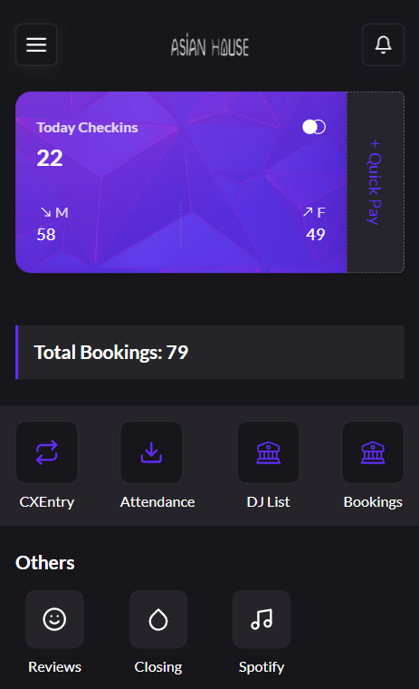
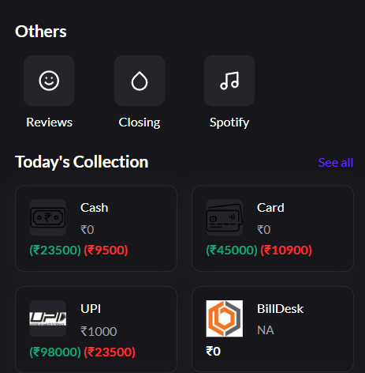
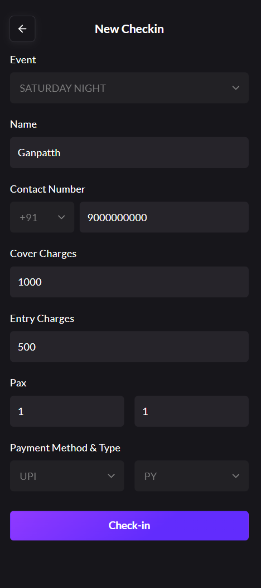
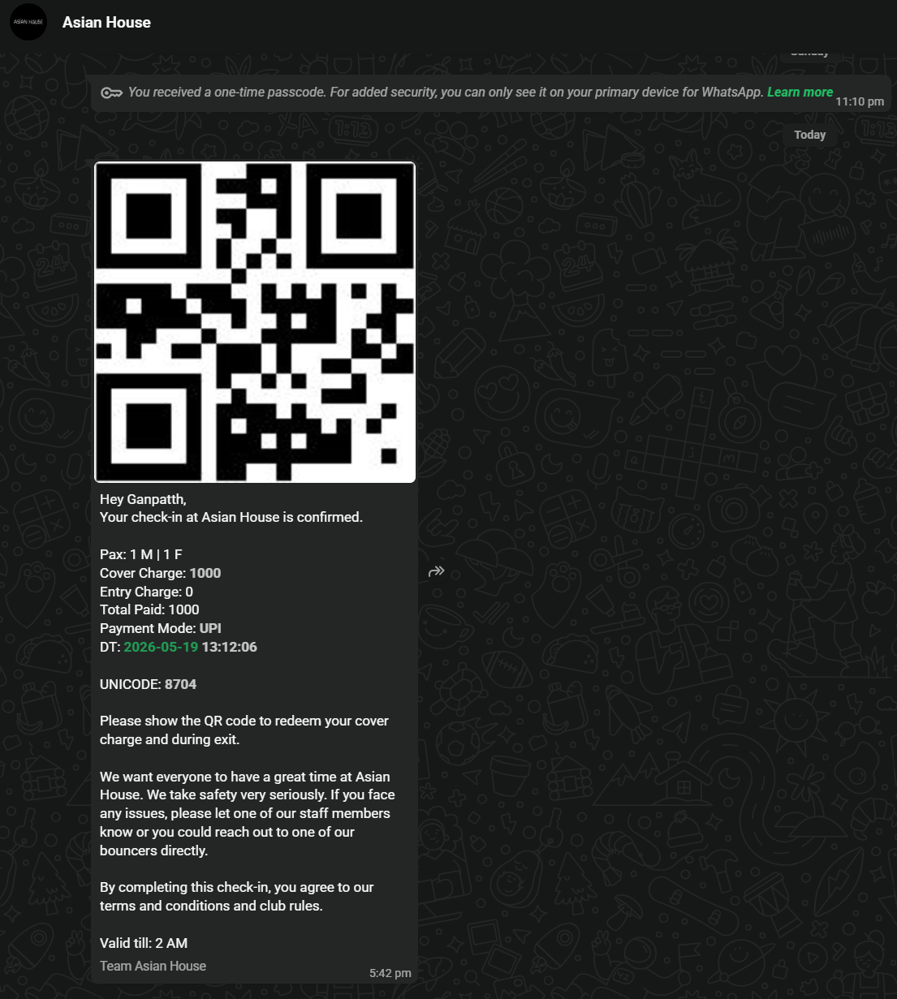
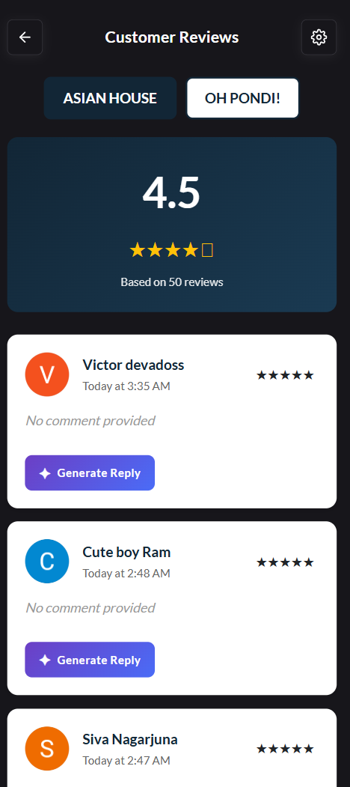
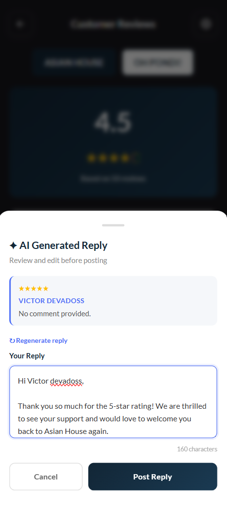
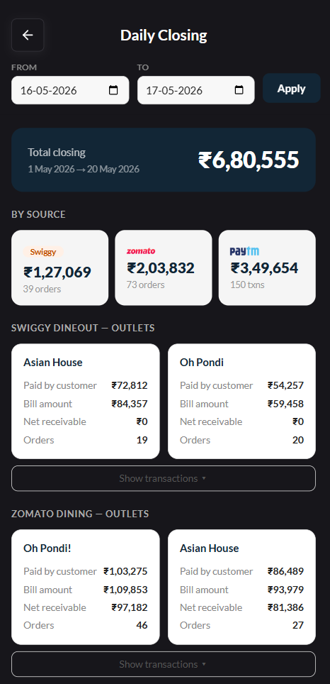
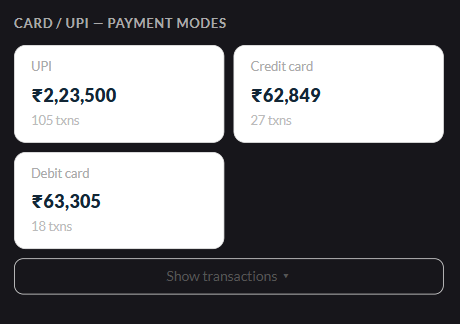

# AHEMP — AH Employee Management Platform

> A proprietary operations and experience management app built. Designed from the ground up for bars and clubs — handling everything from door entry to day-end closing, DJ scheduling, ad lead tracking, and customer reviews.

---

## Table of Contents

- [Overview](#overview)
- [Features](#features)
  - [Dashboard](#dashboard)
  - [CX Entry (Check-In)](#cx-entry-check-in)
  - [WhatsApp Confirmation](#whatsapp-confirmation)
  - [Today's Bookings & Ad Leads](#todays-bookings--ad-leads)
  - [Today's Collection](#todays-collection)
  - [DJ Lineup Manager](#dj-lineup-manager)
  - [DJ Portal](#dj-portal)
  - [Music Control (Spotify)](#music-control-spotify)
  - [Reviews & Google Business Profile](#reviews--google-business-profile)
  - [Closing](#closing)
  - [Attendance](#attendance)
  - [Stock Control](#stock-control)
  - [Bill Check](#bill-check)
  - [Admin Dashboard](#admin-dashboard)
- [Integrations](#integrations)
- [Coming Soon](#coming-soon)
- [Architecture Notes](#architecture-notes)

---

## Overview

**AHEMP** is a full-stack mobile-first application built to streamline the day-to-day operations of big bars and clubs. It replaces fragmented manual processes — paper entry logs, WhatsApp forwards, spreadsheet closing reports — with a single unified platform accessible from any device.

The platform is currently deployed for **Asian House** with the architecture designed to support multiple outlets in the future.

---

## Features

---

### Dashboard

The main landing screen gives managers and staff a real-time pulse on the night's operations.

**What's on the Dashboard:**

- **Today Check-ins** — Live count of total check-ins for the day with a Male/Female breakdown
- **Quick Pay** — A built-in fallback payment option with integrated payment gateway, used when the EDC (card swipe) machine is unavailable. Allows direct collection from customers without interruption
- **Total Bookings** — Shows the count of bookings for the day sourced from ad leads and direct reservations
- **Module Shortcuts** — Quick access to CX Entry, Attendance, DJ List, Bookings, Reviews, Closing, Inventory and Spotify
- **Today's Collection** — Payment breakdown by mode (see [Today's Collection](#todays-collection))

---

### CX Entry (Check-In)

The entry screen is used by the door staff to register every customer walking into the venue.

**Fields captured at entry:**

| Field | Description |
|---|---|
| Event | Select the event/night type (e.g. HD) |
| Name | Customer's name |
| Contact Number | Mobile number with country code |
| Cover Charges | Amount charged as cover (redeemable at the bar) |
| Entry Charges | Separate entry fee if applicable |
| Pax | Number of Male and Female guests in the group |
| Payment Method & Type | e.g. UPI / Card / Cash, and the payment type category |

Once submitted via the **Check-in** button:
- The entry is logged and the cover charge redemption is synced with the POS system
- A WhatsApp confirmation is automatically sent to the customer

---

### WhatsApp Confirmation

Immediately after a successful check-in, the customer receives an automated WhatsApp message using the Meta WhatsApp Cloud API.

**The message includes:**

- Personalised greeting with the customer's name
- Pax breakdown (Male | Female)
- Cover Charge and Entry Charge amounts
- Total paid and payment mode
- Date & time of check-in
- A unique **Unicode** reference code
- A **QR Code** — to be shown at the time of bill payment to redeem the cover charge
- Validity (valid till closing time e.g. 2 AM)
- Safety and club rules note

This removes the need for paper tokens or manual reconciliation of cover charge redemptions. The QR is scanned at the table during settlement, and the cover amount is automatically deducted from the final bill via POS integration.

---

### Today's Bookings & Ad Leads

The Bookings/Reservations screen aggregates incoming leads from advertising platforms and provides a live view of who's expected for the night.

**Stats shown:**

- Total Reservations
- Total Guests
- Male Guests / Female Guests breakdown

**Lead Source Tagging:**

Each reservation is tagged with the source it came from — for example:

- `Google Ads`
- `Meta Ads`

This allows management to directly measure the ROI of their advertising campaigns by seeing how many actual walk-ins were generated per ad platform on any given night. Customer contact details and pax are visible per entry, with timestamps.

---

### Today's Collection

Accessible from the Dashboard by tapping **See All**, this section shows a real-time breakdown of all entry and cover charge payments collected at the door.

**Payment modes tracked:**

| Mode | Description |
|---|---|
| Cash | Physical cash collected at entry |
| Card | EDC / card swipe payments |
| UPI | UPI payments (GPay, PhonePe, etc.) |
| BillDesk | Online payment gateway collections |

Tapping **See All** opens the full customer list for the day, showing:
- Customer name, contact, and pax details
- Editable fields for Admins (Pax & Contact)
- **OTP Resend** option — in case the customer did not receive the WhatsApp message

---

### DJ Lineup Manager

Owners and managers can plan, assign, and track DJ bookings for the entire month from this screen.

**DJ Management:**
- Add new DJs to the roster
- Select any DJ to view or edit their profile and rates

**Slots Management:**
- Search for which DJ is assigned to any given date
- Add new slots with date, time, and DJ assignment
- View per-slot payment status: `Paid` or `Unpaid`
- Edit or delete any slot
- Transaction reference (TXN) visible for paid slots
- The DJ gets an automatic WhatsApp when their slot is marked paid

**Monthly Statistics:**

| Metric | Description |
|---|---|
| Total Spend | Total DJ costs for the month |
| Total Slots | Number of DJ nights booked |
| Paid | Amount already disbursed |
| Unpaid | Outstanding payments |

Month navigation (Previous / Next) lets management plan and review across months.

---

### DJ Portal

<!-- 📸 SCREENSHOT PLACEHOLDER — Add DJ portal screenshot here -->

DJs log in to their own section of the app to see their upcoming slots and their payments for the last three months.

---

### Music Control (Spotify)

<!-- 📸 SCREENSHOT PLACEHOLDER — Add Spotify player screenshot here -->

Staff control the venue's music from the app: see what's playing and the queue, search and request songs, and keep a song catalog. No dedicated master device needed.

---

### Reviews & Google Business Profile

The Reviews module fetches **real-time reviews from the Google Business Profile** of two different outlets.

**Features:**
- Live feed of incoming customer reviews
- AI-powered response generation using **Gemini** — generates contextually appropriate replies to each review
- Staff can **edit** the AI-generated response before posting
- Helps maintain consistent and prompt engagement on the Google listing

**Google Business Profile tools (admin):** profile performance (views, calls, directions), search keywords, posts / events / offers, the Google menu, a review link & QR generator, and alerts for new reviews.

---

### Closing

The Closing module simplifies the end-of-day reconciliation process by automatically pulling in sales data from all integrated payment platforms.

**Integrated sources for closing:**

| Source | Description |
|---|---|
| Paytm (EDC) | Card and POS terminal settlements |
| Zomato Dining | Online payments via Zomato Dining (auto-synced) |
| Swiggy Dining | Online payments via Swiggy Dineout (auto-synced) |

The closing screen presents a consolidated view of total collections across all channels, which can be verified against the POS partner report — making EOD settlement a fast, auditable process rather than a manual reconciliation effort.

---

### Attendance

<!-- 📸 SCREENSHOT PLACEHOLDER — Add attendance screenshot here -->

- Staff punch in and out on a **fingerprint device**; punches sync to AHEMP automatically
- Staff see their own In / Out times in the app
- Owners see who's in today, daily records with breaks, and the raw punch logs
- Salary is calculated from hours worked

---

### Stock Control

<!-- 📸 SCREENSHOT PLACEHOLDER — Add stock control / night report screenshot here -->

**Goal:** Reduce alcohol wastage and catch missing bottles.

- Staff count every fridge each night
- AHEMP compares the count with what should be there: last count + bottles moved in − bottles sold on the POS − write-offs
- Deliveries are picked up automatically from the POS purchase entries
- A **Night Report** and WhatsApp alerts flag missing bottles, missed counts and low stock

---

### Bill Check

Every POS bill is checked automatically for wrong prices, wrong GST or service charge, and items that shouldn't have been billed. A monthly view shows under- and over-charging per item and per staff member.

---

### Admin Dashboard

<!-- 📸 SCREENSHOT PLACEHOLDER — Add admin dashboard screenshot here -->

A desktop panel for owners, alongside the mobile app:

- **Sales & Orders** — POS orders with Print / PDF and a one-tap **Send Report** on WhatsApp, entries, transactions, monthly reports
- **WhatsApp Inbox** — chat with customers, plus an **auto-reply bot** for common questions (timings, location, bookings, menu) that hands off to staff when needed
- **Customers** — every guest's visit history
- **Expenses** — bills, vendors, payables and payments, with a monthly overview
- **Google Ads** — campaign reports; guests who actually checked in are sent back to Google as conversions
- **Digital Menu** — the online menu guests order from, linked to the POS
- **Team** — new staff get an app install link on WhatsApp, upload their ID and salary details for verification, and sign-ins are tracked per device
- **AI Knowledge Base** — one place for the business facts all AI features use

---

## Integrations

| Integration | Purpose |
|---|---|
| **Meta WhatsApp Cloud API** | Check-in confirmations, alerts, reports, inbox & auto-replies |
| **POS System (PetPooja)** | Entry data sync; cover charge redemption via QR at bill; bill checks & stock |
| **Payment Gateway** | Quick Pay fallback for card machine downtime |
| **Paytm EDC** | Day-end closing reconciliation |
| **Zomato Dining** | Online dining bookings & closing data |
| **Swiggy Dining** | Online dining bookings & closing data |
| **Google Ads** | Lead tracking, ad reports & offline conversions |
| **Meta Ads** | Lead tracking & ad performance via bookings |
| **Google Business Profile** | Reviews, performance, posts & menu |
| **Gemini AI** | AI-generated responses for Google Reviews |
| **BillDesk** | Online payment collection tracking |
| **Spotify** | Venue music control |
| **Fingerprint Device (eSSL)** | Staff attendance punches |

---

## Coming Soon

### Smart Bottle Scale
A weighing machine built in-house: place an open bottle on it and it tells you how much is left, synced straight into Stock Control. This brings stock tracking down from full bottles to the exact pour.

### Advanced Ads Insights
- Extended Google Ads conversion reports
- Competitor spend analysis
- Suggestions on what to change in each campaign
- A special discount coupon for guests who sign up through Google Ads, so every visit can be tracked accurately

### Outlet & Guest Analytics
- Average peak times of the outlet, by day, week and month
- How long guests stay on average
- Average table spend by group size

### AI Stock Forecasting
Predict how much stock is needed for the coming days, based on past sales and trends.

### Attendance — Face Recognition & Geolocation
- **Face Recognition** attendance marking
- **Geolocation fencing** — attendance only valid within the venue premises
- Preset shift management (opening, floor, bar, closing)
- Salary adjustments for late arrivals, overtime and leave balances

---

## Architecture Notes

- Built as a **mobile-first** application
- Designed to support **multi-outlet expansion** —  outlet-level configuration is part of the planned architecture
- All sensitive credentials, API keys, and backend configuration are managed via environment variables and are **not included in this repository**
- The source code is **proprietary and confidential** — this README exists for documentation and onboarding purposes only

---

> **AHEMP** is a proprietary product. Unauthorised distribution, reproduction, or use of this software is strictly prohibited.
>
> © 2026 Asian House. All rights reserved.
